<div align="center">

<h1>江南烟雨 · Jiangnan in the Rain</h1>

<p><b>Pole a covered boat through a water town in Jiangnan: apricot blossom in the spring rain, summer showers on the lotus, maples and frost in autumn, snow on the dark tiles in winter.</b></p>

<p><a href="README.md">中文</a> · <a href="README.en.md">English</a> · <a href="docs/PLAN.md">Plan</a> · <a href="CREDITS.md">Credits &amp; licences</a></p>

<p>   </p>

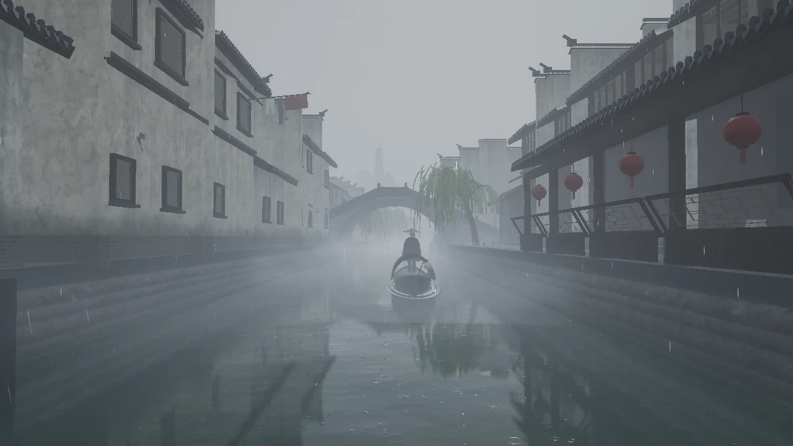

</div>

Rendered live with three.js, in plain JavaScript, with no engine and no framework. The houses, bridges, boats, willows, maples, apricots, lotus and walkers are all generated by code, and so are the rain, the birds and insects, the oar and the bell: there is not one audio file.

The approach follows [Sakura Fantasy](https://github.com/billpwchan/sakura-fantasy) (MIT). The shared uniforms, the render pipeline, the water's reflections and some other modules are adapted from its code; see [CREDITS.md](CREDITS.md). Dependencies and scripts are managed by the `package.json` in this directory.

> The screenshots on this page were taken with software rendering on a machine with no graphics card (the `q=high` tier, 1280×720). It is only much slower than on a GPU; the picture is the same.

## The look

<table>
<tr><td width="50%" align="center" valign="top"><a href="docs/media/spring-bridge.webp">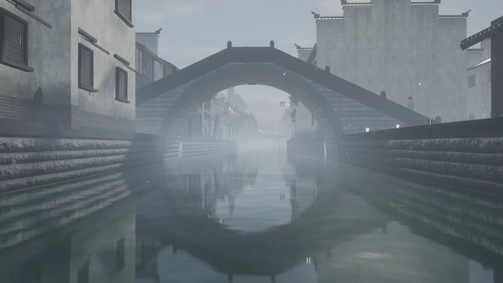</a><br><b>Spring · the stone bridge</b>: a semicircular arch springing from the water, closing into a circle with its reflection</td><td width="50%" align="center" valign="top"><a href="docs/media/spring-apricot.webp">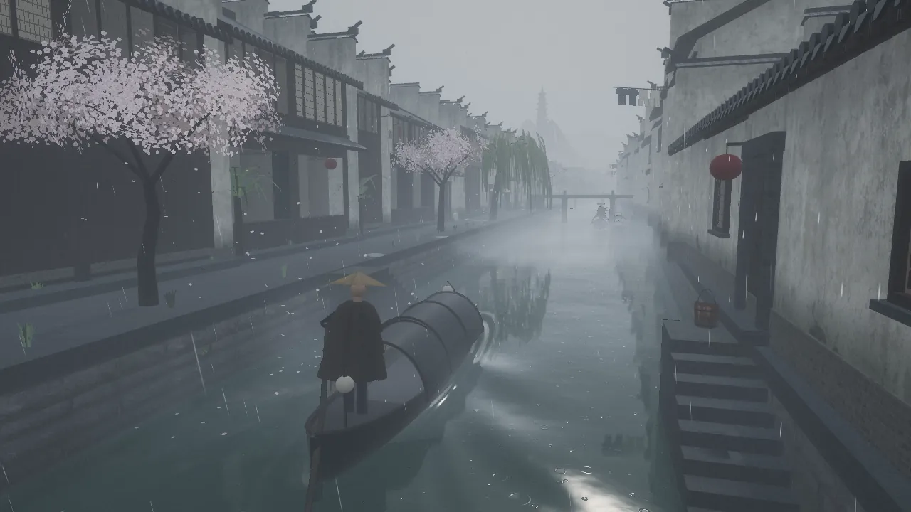</a><br><b>Spring · apricot rain</b>: blossom falling and afloat on the water, willow down drifting on a dry morning</td></tr>
<tr><td width="50%" align="center" valign="top"><a href="docs/media/summer-storm.webp">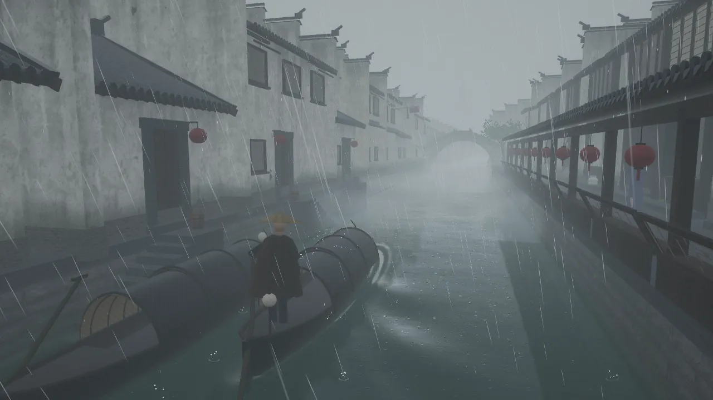</a><br><b>Summer · white rain leaping like beads</b>: an afternoon storm, drops bouncing off the water and the awnings, thunder rolling</td><td width="50%" align="center" valign="top"><a href="docs/media/summer-night.webp">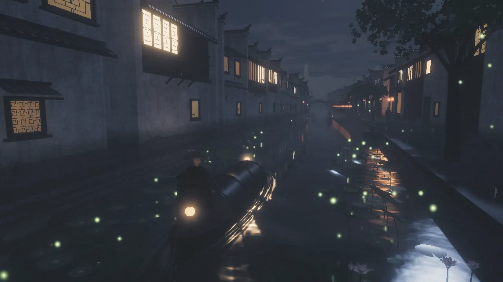</a><br><b>Summer · the lotus at night</b>: lotus leaves out to the sky, fireflies low over them after the rain, frogs all round</td></tr>
<tr><td width="50%" align="center" valign="top"><a href="docs/media/autumn-dusk.webp">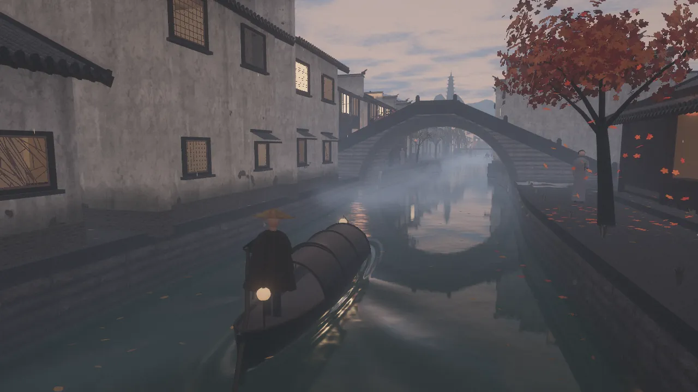</a><br><b>Autumn · maples</b>: willow leaves turning one by one, the maples red, fallen leaves drifting off on the water</td><td width="50%" align="center" valign="top"><a href="docs/media/autumn-midnight.webp">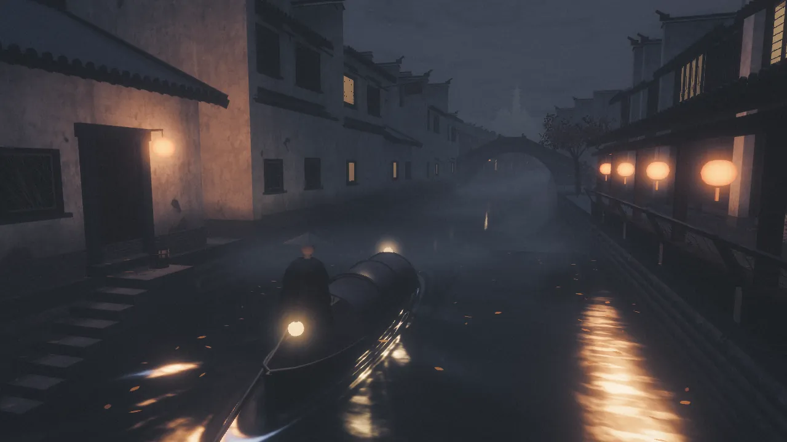</a><br><b>Autumn · the midnight bell</b>: mist at midnight, frost on the roofs, crickets, a temple bell far off</td></tr>
<tr><td width="50%" align="center" valign="top"><a href="docs/media/winter-snow.webp">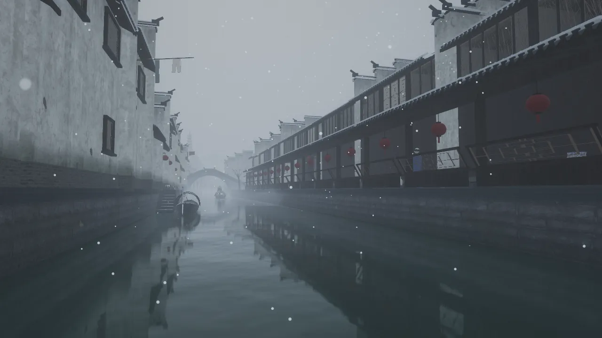</a><br><b>Winter · light snow</b>: white lines along the eaves, snow on the awnings, hats and umbrellas, and the near silence of falling snow</td><td width="50%" align="center" valign="top"><a href="docs/media/winter-roofs.webp">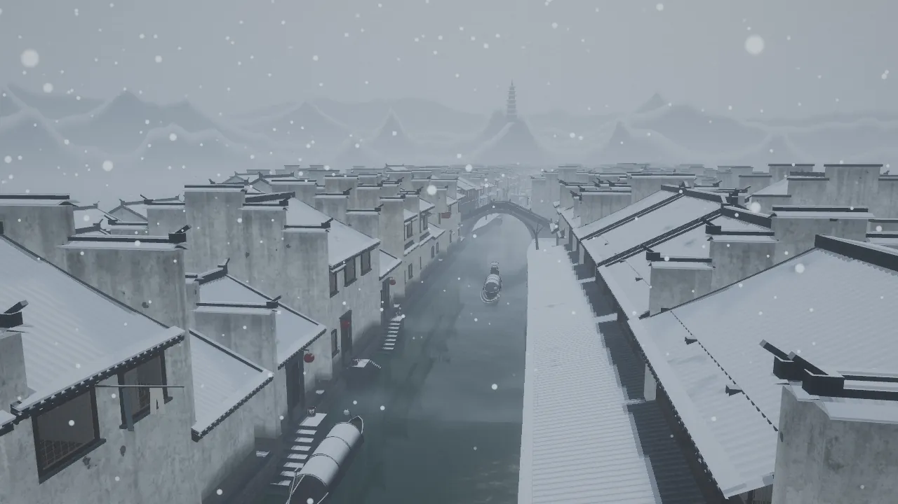</a><br><b>Winter · white snow, dark tiles</b>: the town from above, the hills and the pagoda white as well</td></tr>
<tr><td width="50%" align="center" valign="top"><a href="docs/media/dusk.webp">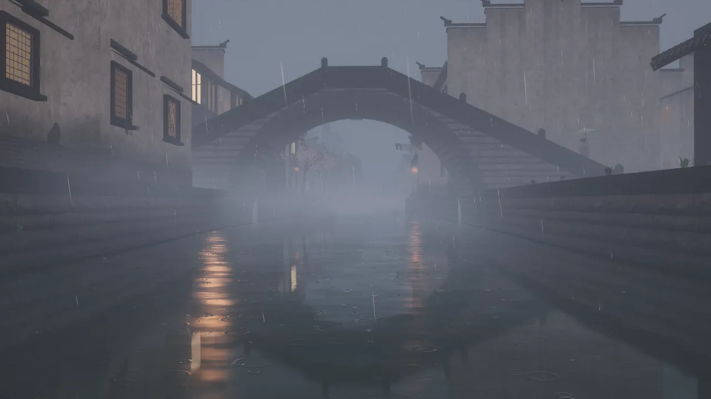</a><br><b>Dusk</b>: windows light up one by one, their light broken into columns on the water</td><td width="50%" align="center" valign="top"><a href="docs/media/journey.webp">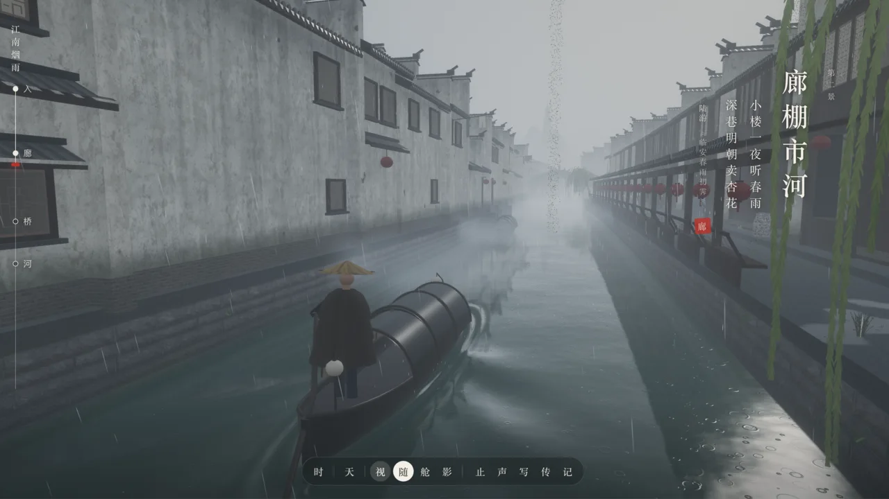</a><br><b>The interface</b>: the scroll of the journey on the left, season, hour, weather and view in the dock</td></tr>
</table>

## Features

- **Four seasons**: in spring the apricots blossom, willow down drifts and birds sing at first light; in summer the willows are deep green, lotus leaves and flowers stand out of the water, an afternoon storm sends the drops leaping (白雨跳珠), fireflies fly low at night among the frogs and cicadas sing by day; in autumn the willow leaves turn one by one, the maples go red, fallen leaves float on the water and gather under the eaves, the lotus withers, clear nights bring frost and crickets sing; in winter the willows are bare twigs, snow lies on the roofs, the slabs and the awnings, the eaves are lined with white and the hills are capped. A change of season eases in over a few seconds
- **The rain itself**: rain streaks, ripples on the water, drips off the eaves, wet slabs and puddles, mist drifting over the canal. A rain-occlusion map keeps the corridor, the eaves and the bridge's arch dry
- **Water**: reflections taken along the reflected ray and broken by ripples, refraction and absorption, the boats' wakes; at night the lanterns' light is broken into glints on the surface
- **A procedural Jiangnan**: stepped firewalls (马头墙), small grey tiles, the beauty's bench (美人靠), steps to the water, a single-span stone arch, three-span slab bridges, a covered corridor, a memorial gate; about 550 houses, the same town every time
- **Life**: weeping willows, maples, apricots, lotus, covered boats with a boatman at his oar, walkers under oil-paper umbrellas (folded when the rain stops or under the corridor), shop banners and laundry
- **Time of day and night**: windows light one by one with rooms of some depth behind the glass, go dark late at night, and the lanterns go out first at dawn
- **Sound**: the rain in layers (the wash over the town, drops in the canal and on the stones, the drumming on a roof just overhead), changing as you pass under the corridor, through the arch or into the cabin; drips, the oar's creak and swish, thunder, a temple bell at midnight and at first light; birds on spring mornings, summer's cicadas and frogs, autumn's crickets and dry leaves, the hiss of falling snow, all synthesized live with Web Audio
- **Runs smoothly**: render resolution adjusts itself, levels of detail, and a lighter tier for phones

## Run

```bash
npm install
npm run dev          # http://localhost:5192
```

`npm run build` writes the static site to `dist/` (relative paths, so it opens under any sub-path), and `npm run preview` serves the build on port 5193.

The textures and prop models are in `public/assets/`; nothing needs downloading. To change the textures or regenerate them, run `npm run fetch-assets`, then `node scripts/simplify-props.mjs` to cut the scanned props to about a thousand triangles each and the textures to 256 (both need ImageMagick).

A recent Chrome, Edge or Safari is recommended; WebGL2 is required.

## Milestones

| Stage | What | Status |
|---|---|---|
| M0 | Skeleton: project, render pipeline, shared uniforms, time of day and weather, frame-time governor, capture script | ✅ |
| M1 | A stretch of canal: procedural houses, a stone arch bridge, embankments, water, rain, mist | ✅ |
| M2 | Rain and mist in detail: the rain-occlusion map, a covered corridor, eave drips, puddles, mist banks on the water, ink-wash hills | ✅ |
| M3 | Life: willows, covered boats with a boatman sculling, wakes, walkers with umbrellas, banners and laundry, props, grass, lotus pads and banana plants | ✅ |
| M4 | Journey and interaction: the opening, four places down the canal by boat, poem cards, four views (follow / seat / cinema / photo), the dock, jumping between places, share links, the town gate | ✅ |
| M5 | Time and night: windows lighting one by one, lights out late at night, rooms behind the glass, shop lanterns, lantern halos, glints on the water, town glow on the clouds, lanterns out at dawn | ✅ |
| M6 | Sound: the rain's wash, drops on water and stone, the drumming on a roof overhead, muffled and echoing under the corridor and the arch; eave drips, the oar's creak and swish, water, thunder, the bell at midnight and at first light, all synthesized live with Web Audio | ✅ |
| M7 | Seasons and winter: the season as an axis beside the weather, a new season each journey; light and heavy snow and snow lying, bare willows, snow on the hills, winter's poems; sound starts muted | ✅ |
| M7.1 | Winter touch-ups: snow along the eaves, boats and walkers keep their snow under the bridge, lighter snowy nights, snow on the pagoda, a smoke test | ✅ |
| M8 | Autumn: yellowing willows, maples, fallen leaves (falling, afloat, on the slabs), withered lotus, frost, crickets, autumn's poems | ✅ |
| M9 | Summer: deep greens, standing lotus and flowers, leaping storm drops, fireflies, cicadas and frogs, summer's poems; eight journeys through the seasons | ✅ |
| M9.1 · M10 | Summer touch-ups; spring filled out (apricot blossom and falling petals, willow down, birds at dawn), seasons' transitions and poems checked, performance checked, this page updated | ✅ |

## The journey

The page opens on the title, with a poem chosen for the season of the journey. Press 启程 or Enter and your boat sets off from the gate at the head of the town, down the canal through four places. At each, a vertical poem card appears on the right, its poem chosen for the season too:

| | Opening | 1 烟雨入镇 | 2 廊棚市河 | 3 石桥烟柳 | 4 枕河人家 |
|---|---|---|---|---|---|
| Spring | Du Mu 《江南春》 | Wei Zhuang 《菩萨蛮》 | Lu You 《临安春雨初霁》 | Zhi Nan 《绝句》 | Du Xunhe 《送人游吴》 |
| Summer | Yang Wanli 《晓出净慈寺送林子方》 | Zhao Shixiu 《约客》 | He Zhu 《青玉案》 | Su Shi 《六月二十七日望湖楼醉书》 | Li Chongyuan 《忆王孙·夏词》 |
| Autumn | Du Mu 《寄扬州韩绰判官》 | Li Shangyin 《宿骆氏亭寄怀崔雍崔衮》 | Li Qingzhao 《声声慢》 | Zhang Ji 《枫桥夜泊》 | Li Shangyin 《夜雨寄北》 |
| Winter | Liu Zongyuan 《江雪》 | Zhang Dai 《湖心亭看雪》 | Bai Juyi 《问刘十九》 | Zheng Gu 《雪中偶题》 | Bai Juyi 《夜雪》 |

The poems and the places agree: in spring apricots blossom at the corridor and by the bridge ("tomorrow in the deep lanes they will sell apricot blossom", "apricot rain that wets the coat"), in summer there are frogs in the lotus where the town begins ("frogs in every green pond"), in autumn maples stand at the bridge and a bell sounds at midnight ("river maples and fishing lights", "the midnight bell reaches the traveller's boat"), and in winter the town is "white above and below".

A journey takes a little over four minutes. At the end of the town a sheet of paper comes down, the season, the hour and the weather change, and the boat sets off from the gate again, eight journeys through the four seasons:

spring · 辰 · light rain → summer · 未 · storm → autumn · 酉 · clearing → winter · 巳 · light snow → spring · 卯 · mist → summer · 戌 · clearing → autumn · 子 · mist → winter · 申 · heavy snow

Once you change the season, the hour or the weather in the dock, it stops following the journey; press 「自」 to hand it back.

Sound starts muted; press M or 静 in the dock to turn it on, and this device remembers.

| Control | What it does |
|---|---|
| W / S · ↑ / ↓ | Faster · slower |
| A / D · ← / → | Steer, drifting left and right in the canal |
| Drag · wheel · two fingers | Look around · distance (pinch only works in the follow view) |
| C | Follow → seat → cinema. Cinema cuts between under the bridge, the corridor, the bank, the bow and high above; as the boat nears the arch it looks back through it from the far side |
| Space | Moor · set off |
| P | Photo: a frame, and the shutter saves a PNG with the 「江南烟雨」 seal |
| M | Sound on or off, remembered on this device |
| H · Esc | Hide the interface · close a sheet |
| The scroll on the left | The four places and where the boat is; click one to jump there |
| The dock: 季 · 时 · 天 · 视 | Season, hour slider (4:30 to 4:30 the next morning), weather, view; 止 (moor), 声 (sound, shown as 静 when muted), 写 (photo), 传 (copy a link to this moment), 记 (about) |

The address bar follows the journey (`?z=` is the boat's place, from the second journey `j` is its number, and `s` `h` `w` `mode` are added once set by hand). Copy it and it opens on the same place, season, hour and weather, skipping the opening. The address bar also keeps this device's own `q` `scale` `ui`; a link you share does not carry them.

## Review mode

Open with `shot`, `cam` or `review` and you get review mode: no journey, and a review panel at the lower right.

| Control | What it does |
|---|---|
| The panel · Shot | Seven fixed shots: canal, arch bridge, steps to the water, corridor (from the water), under the corridor (standing in it), street, willow bank; plus a glide (down the canal at boat height) and free (orbit) |
| Drag · wheel | Look around · zoom (dragging in a fixed shot switches to the free camera) |
| Season | Spring, summer, autumn, winter |
| Hour slider | 4:30 to 4:30 the next morning, shown in the twelve double-hours |
| Weather | Mist, light rain, rain, storm, clearing, light snow, heavy snow |
| H | Hide the interface |
| M | Sound on or off (it starts muted) |

## URL parameters

| Parameter | Meaning | Example |
|---|---|---|
| `z` | Journey: the boat's place on the canal, from 74 (the gate) to −252 (the end of the town) | `z=-60` |
| `mode` | Journey: the view, `follow` `seat` `cinema` | `mode=cinema` |
| `intro` | Journey: show the opening first even with `z` `h` `w` `mode` given | `z=-60&intro` |
| `review` | Enter review mode | `review` |
| `shot` | Review shot: `alley` `bridge` `pier` `corridor` `lane` `street` `willows` `glide` `free`, and for debugging `roofs` `landing` `hills` `boat` `gate` | `shot=bridge` |
| `warm` | Run the boats and walkers this many seconds before the first frame (a wake needs a track behind it to show), at most 120 | `warm=20` |
| `j` | Journey: which one (0 is the first, eight to a round), which sets its season, hour and weather | `j=3` |
| `s` | Season: `spring` `summer` `autumn` `winter` | `s=autumn` |
| `h` | Hour, 0–24 (the hour sliders run from 4:30 to 4:30 the next morning) | `h=17.7` |
| `w` | Weather: `mist` `drizzle` `rain` `storm` `after` `snow` `blizzard` | `w=snow` |
| `cam`, `look`, `fov` | A fixed camera position, its target (`x,y,z`) and field of view | `cam=8,6,-70&look=0,2,-95` |
| `q` | Quality tier: `high` (the desktop default); `mobile` (the default on phones and small tablets: no MSAA, fewer shadows, reflections, bloom and raindrops, at most 1.5 pixels per CSS pixel); `low` turns off MSAA and shadows and shrinks the mirror, for machines without a graphics card | `q=low` |
| `scale` | Render resolution scale, 0.25–1 | `scale=0.5` |
| `ui` | `ui=0` hides the interface | |

For example: [the arch bridge after the rain](http://localhost:5192/?shot=bridge&w=after&h=14), [light rain at dusk](http://localhost:5192/?shot=bridge&h=17.7), [apricots in the rain](http://localhost:5192/?z=-100&s=spring&w=drizzle&h=10), [the lotus on a summer night](http://localhost:5192/?z=58&j=5), [maples](http://localhost:5192/?z=-58&j=2), [the corridor in snow](http://localhost:5192/?shot=corridor&s=winter&w=snow&h=10). (Run `npm run dev` first.)

## Capture script

```bash
npm run dev &
node scripts/capture.mjs                          # alley / bridge / pier, saved to captures/
node scripts/capture.mjs "dusk:shot=bridge&h=18"  # name:query
SOFT=1 node scripts/capture.mjs                   # software GL for a machine with no GPU (slow, about a minute a shot)
```

Environment variables: `URL`, `OUT`, `W`/`H` (default 960×540), `Q` (default `low`), `CHROME` (browser path), `PARAMS` (added to every shot), `UI=1` (keep the interface; `ui=0` is added by default), `KEEPLOAD=1` (keep the title page), `WAIT` (seconds to wait once the picture is up, for interface animations).

A shot of the journey uses the `name:query` form without `shot`, for example `UI=1 WAIT=8 node scripts/capture.mjs "bridge:z=-50&mode=cinema"`.

`npm run smoke` (run `npm run dev` first) draws two frames of every season and weather, at noon and at night, on the journey and in review, and checks for shader and console errors; it exits 1 on a problem.

## Project layout

```
src/
├── main.js           boot, the frame loop, and the two ways in: journey and review
├── core/             shared uniforms and material patching, render pipeline and governor, post, texture loading, quality tiers, the rain-occlusion map (occlusion.js)
├── env/              time of day, weather and season: targets eased into the shared uniforms, snow settling and melting, frost
├── world/
│   ├── layout.js     the canal's centre line and width, which bank has houses on the water and which a lane, the bridge's place
│   ├── kit.js        geometry accumulator: parts merged into meshes by material, with foot and eave heights as attributes
│   ├── materials.js  shading for lime walls, dark tiles, embankment stone, slabs, timber, lattices
│   ├── house.js      the house grammar: bays, depth, floors, gables (plain / stepped firewalls), canal-side back walls or street shop fronts, waist eaves, steps to the water
│   ├── town.js       planning of three rows of lots along both banks, chunked building, instanced tile ends
│   ├── banks.js      embankments, coping, slab paving, the bed, steps along the street
│   ├── bridge.js     the single-span semicircular arch bridge
│   ├── slabbridge.js the two three-span slab bridges of 枕河人家
│   ├── corridor.js   the covered corridor: sloping roof, posts, beauty's bench, red lanterns
│   ├── hills.js      ink-wash hills and the pagoda
│   ├── willow.js     weeping willows: trunk, arching limbs, strands swaying in the wind, leaves turning and falling with the seasons; maples and apricots in a few of their places
│   ├── maple.js      maples and apricots: wood merged into the willows' mesh, crown cards that blossom, green, redden and fall with the seasons
│   ├── boat.js       covered boats, the boatman sculling, boats on the canal
│   ├── people.js     walkers under oil-paper umbrellas: along the bank, over the bridge, folding up when the rain stops or under the corridor
│   ├── cloth.js      shop banners and laundry, swaying
│   ├── props.js      buckets, baskets, wine jars, pots (Poly Haven scans)
│   ├── plants.js     grass at the wall foot, ferns on the embankment, banana plants; lotus: pads, summer's standing leaves and flowers, broken stems in autumn and winter
│   ├── gate.js       the town gate
│   ├── water.js      the water: reflections along the reflected ray, roughness blurred from ripples, refraction and absorption, raindrop rings, wakes
│   ├── sky.js        overcast cloud and sky
│   └── textures.js   procedural lattice atlas (squares, 步步锦, cracked ice, fret)
├── fx/               rain (rain.js), snow and willow down (snow.js), eave and awning drips (drips.js), storm splashes (splash.js), falling leaves and petals (leaves.js), fireflies (fireflies.js), mist banks (mist.js), lantern halos (halos.js)
├── audio/            sound: synthesis (synth.js: noise, drops, drips, oar, thunder, bell, birds, cicadas, frogs, crickets, dry leaves, reverb tail), mixing and triggers (soundscape.js: shelter, drips, oars, bell, thunder, each season's creatures, mute)
├── journey/
│   ├── route.js      the route: start and end, the four places and their poems for each season, each journey's season, hour and weather, how far the boat may stray
│   ├── journey.js    the boat's progress: cruising and pace, steering, reaching a place, the end
│   ├── director.js   the journey's cameras: follow, seat, cinema cuts, photo
│   └── camera.js     review mode's fixed shots, glide and free orbit
└── ui/               the journey's interface (journey-ui.js: opening, poem cards, scroll, dock, photo, share), the review panel (panel.js)
scripts/              texture download, capture, per-pass costs (perf.mjs), smoke test (smoke.mjs)
docs/PLAN.md          the plan and milestones (in Chinese)
docs/media/           this page's screenshots
```

## Where to change things

- House proportions and how often each kind appears: `planRow` in `world/town.js` (bays, depth, floors, gable type, waist eaves, steps to the water)
- How a kind of part looks: `world/house.js` (`roof`, `firewall`, `waterFace`, `shopFace`, `waistEave`, `pierSteps`)
- Rain streaks, rising damp and flaking on the walls: `plaster` in `world/materials.js`
- Weather: `WEATHERS` in `env/environment.js`; the fog's density is the `uFogParams` line in the same file
- Seasons: each season's light and air, how fast snow settles and melts, and frost are in `update` in `env/environment.js`; the plants' colours through the year are in their own materials (willow leaves in `world/willow.js`, maples and apricots in `world/maple.js`, grass, banana plants and lotus in `world/plants.js`, moss in `world/materials.js`), all reading `uSeason`
- The corridor's place and length: `CORRIDOR` in `world/layout.js`; its lanterns and bench are in `bay` in `world/corridor.js`
- How much water lies in puddles: the `level` line in `slab` in `world/materials.js`; how thick the mist is: `dens` in `fx/mist.js`
- The hills: `RINGS` in `world/hills.js` (radius, height, relief) and the pagoda's place `PAGODA_AIM`
- Where the willows stand and how thick: `planWillows` (spacing) and `createWillows` (limbs, strands per limb, strand length) in `world/willow.js`; where the maples and apricots stand: `MAPLES` and `APRICOTS` in the same file
- The lotus ponds: `PONDS` in `world/plants.js`; how many falling leaves, petals, willow down, fireflies and storm splashes: each tier in `core/quality.js`
- The boat: hull shape in `hullW` `sheer` `draft` at the top of `world/boat.js`; the number and speed of boats on the canal in `main.js` and `BoatTraffic`
- Walkers: their number is `new People(10)` in `main.js`, the colours of clothes and umbrellas at the top of `world/people.js`
- The four places, their poems for each season and their seals, and each journey's season, hour and weather: `CHAPTERS` and `LOOPS` in `journey/route.js`; the opening poems are `OPENINGS` in the same file
- Boat speed: `cruise` (m/s) in `journey/journey.js`; the cinema cuts: `nextShot` and `update` in `journey/director.js`; the framing on a phone held upright: `MIN_ACROSS` (the least width to see across) and `MAX_TALL` in the same file, and `tall` in the follow view
- The gate's place and plaque: `GATE` in `world/layout.js`; the slab bridges' place and size: `SLAB_BRIDGES` and `SLAB` in the same file (the house at the bridgehead makes way, and willows and steps keep clear)
- The canal-side facades: `floorsOf` (each house's storey heights), `upperTimber` (how many have a timber upper floor) and `balconyZ` (the balcony) in `world/house.js`
- The night: the order windows light in, the share that stay dark, and lights out late at night are `jnLit` in `world/materials.js`, the rooms behind the glass `jnRoom`; when lanterns light and go out and when windows go dark are in `env/environment.js` (`lampOn`, `uWinOff`); how far a lantern lights is `sfLamps` in `core/shared.js`; the halos' size is in `fx/halos.js`; how many shop lanterns there are is `shopFace` in `world/house.js`
- Sound: how each layer's level follows the rain, and when the birds and insects sing, is `params` in `audio/soundscape.js`, and what counts as roofed over is `shelter` in the same file; the triggers for drips, oars and the bell are `drips`, `oars`, `bells` (the bell's hours in `bellHours`), and thunder is `strike`; the sounds themselves are in `audio/synth.js` (the bell's partials are `PARTIALS`)
- Debugging, in the browser console: `jiangnan.app.setShot('bridge')` (review mode), `jiangnan.app.setSeason('autumn')`, `jiangnan.app.setWeather('after')`, `jiangnan.app.setHours(18)`, `jiangnan.app.jumpTo(2)` (the journey, to the third place), `jiangnan.sound.level()` (the level just now)

## Performance

- The governor adjusts the render resolution between 0.5 and 1.0 to keep frame time within budget (off with `?q=low`)
- The town is merged into 80 m chunks, one draw call per material per chunk; the first row of houses is in full detail along the whole route, simpler the farther it is from it
- Full-detail houses come in runs of 60 m, and each run also gets a copy one level of detail down: the view draws full detail within 55–65 m of the camera, and the mirror and the distance draw the copy (the mirror has a quarter of the resolution and is broken up by ripples, so detail is wasted there). The random choices only full detail uses (lattice patterns) draw from their own sequence, so the copy and the house have their doors and windows in the same places
- Tile ends and drip tiles are drawn instanced, in batches of 40 m per bank that the frustum can cull, not drawn beyond 75 m, and kept out of the mirror and the rain-occlusion map
- Scanned props are cut to about a thousand triangles each and cast no shadows
- The shadow box sits ahead of the camera and moves in whole shadow-map texels (shadow edges do not crawl as the boat goes); under a weak sun (rain, night) the shadow map is redrawn only every 8 frames
- The rain-occlusion map is redrawn only when the camera has moved more than 10 m (a depth-only render from straight above, buildings only); the rain, puddles, ripples and how wet the ground is all read it
- Phones and small tablets get the `mobile` tier automatically
- What belongs to a season is not drawn out of it: the particle meshes are skipped while no rain, snow, leaves or willow down fall, summer's standing lotus is in two batches by pond and not drawn beyond 110 m, the maples' and apricots' crowns are not drawn in winter; the leaves on the water and the slabs are only worked out in autumn (the petals only in spring)
- Sound starts muted, and the AudioContext is made only when sound is turned on; all sound is synthesized in pieces over the frames after it (each within a dozen milliseconds or so, a cicada or a bird a piece); thunder only once a storm is chosen, the bell only when its hour comes round and each season's creatures only once that season comes; the AudioContext is suspended while muted or in a hidden tab
- Measuring: `node scripts/perf.mjs "z=-22&h=19.5&q=high&ui=0"` counts draw calls, triangles and memory pass by pass (run `npm run dev` first)

## Credits

The approach is from [Sakura Fantasy](https://github.com/billpwchan/sakura-fantasy) (MIT); textures and prop models are from [Poly Haven](https://polyhaven.com) (CC0); all sound is synthesized in code; the poems are by Du Mu, Wei Zhuang, Lu You, Zhi Nan, Du Xunhe, Yang Wanli, Zhao Shixiu, He Zhu, Su Shi, Li Chongyuan, Li Shangyin, Li Qingzhao, Zhang Ji, Liu Zongyuan, Zhang Dai, Bai Juyi and Zheng Gu. See [CREDITS.md](CREDITS.md).
