<div align="center">

<h1>江南烟雨 · Jiangnan in the Rain</h1>

<p><b>撑一只乌篷船穿过一座江南水乡古镇：春天杏花细雨，夏天荷塘骤雨，秋天江枫霜夜，冬天雪落黛瓦。</b></p>

<p><a href="README.md">中文</a> · <a href="README.en.md">English</a> · <a href="docs/PLAN.md">实现计划</a> · <a href="CREDITS.md">致谢与许可</a></p>

<p>   </p>

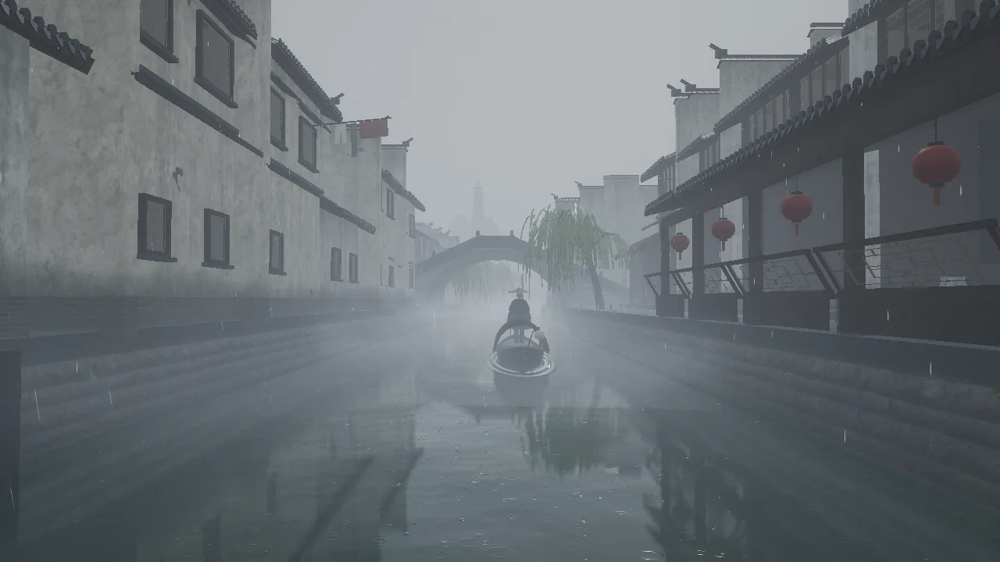

</div>

three.js 实时渲染，原生 JavaScript，不用引擎和框架。房屋、桥、船、柳树、江枫、杏花、荷、行人都由代码生成，雨声、虫鸣鸟叫、橹声、钟声也是实时合成的，没有一个录音文件。

实现思路参考了 [Sakura Fantasy](https://github.com/billpwchan/sakura-fantasy)（MIT）。共享参数、渲染管线、水面倒影等模块是在它的代码上改写的，见 [CREDITS.md](CREDITS.md)。工程依赖和脚本由目录内的 `package.json` 管理。

> 本页的截图是在没有显卡的机器上用软件渲染截的（`q=high` 画质档，1280×720），只是比在显卡上慢得多，画面是一样的。

## 画面

<table>
<tr><td width="50%" align="center" valign="top"><a href="docs/media/spring-bridge.webp">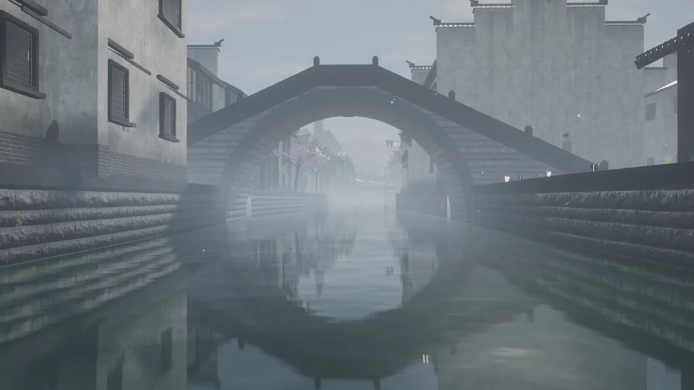</a><br><b>春 · 石桥烟柳</b>：半圆拱落在水面上，拱和倒影合成一个圆</td><td width="50%" align="center" valign="top"><a href="docs/media/spring-apricot.webp">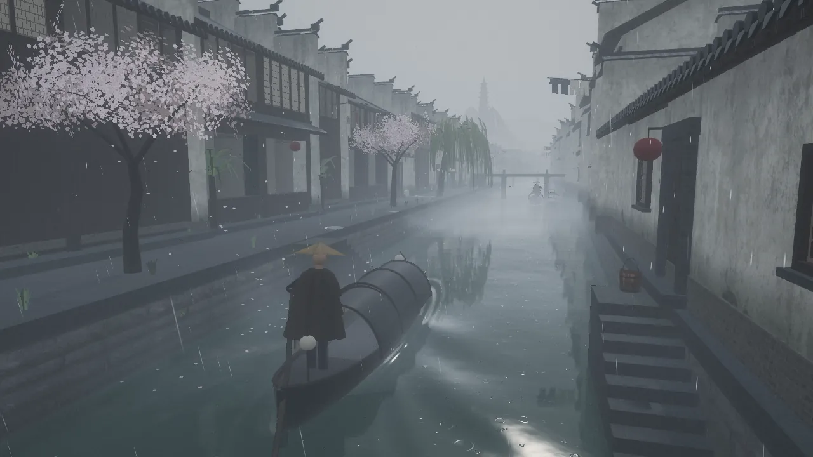</a><br><b>春 · 杏花雨</b>：沾衣欲湿杏花雨，花瓣飘落、漂在水上，晴天的上午空中飘着柳絮</td></tr>
<tr><td width="50%" align="center" valign="top"><a href="docs/media/summer-storm.webp">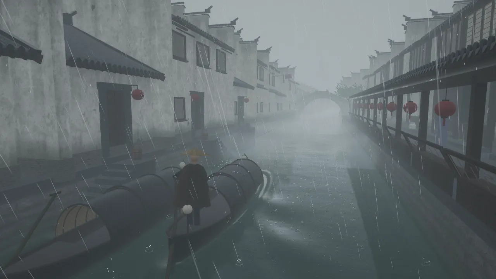</a><br><b>夏 · 白雨跳珠</b>：午后骤雨，水面和船篷上跳起水珠，雷声滚过</td><td width="50%" align="center" valign="top"><a href="docs/media/summer-night.webp">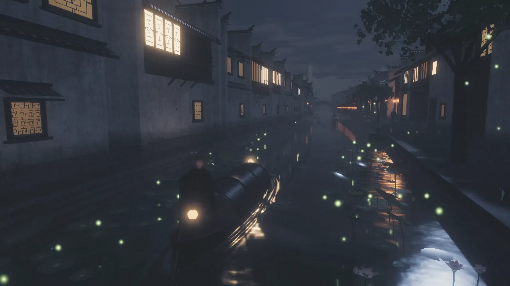</a><br><b>夏 · 荷塘夜</b>：接天莲叶，雨后的夏夜萤火低飞，蛙声一片</td></tr>
<tr><td width="50%" align="center" valign="top"><a href="docs/media/autumn-dusk.webp">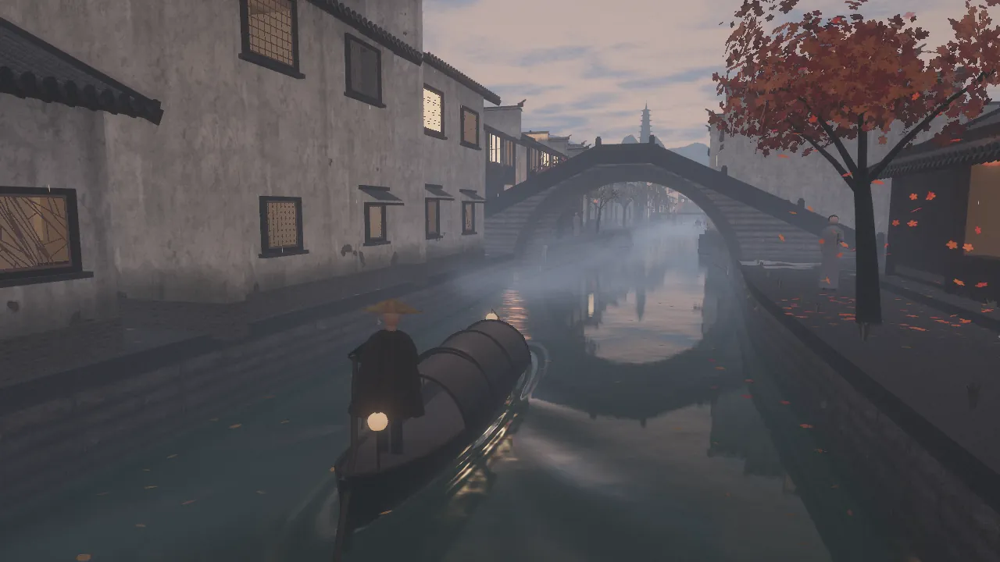</a><br><b>秋 · 江枫</b>：柳叶一片片转黄，江枫红了，落叶飘到水上随水漂走</td><td width="50%" align="center" valign="top"><a href="docs/media/autumn-midnight.webp">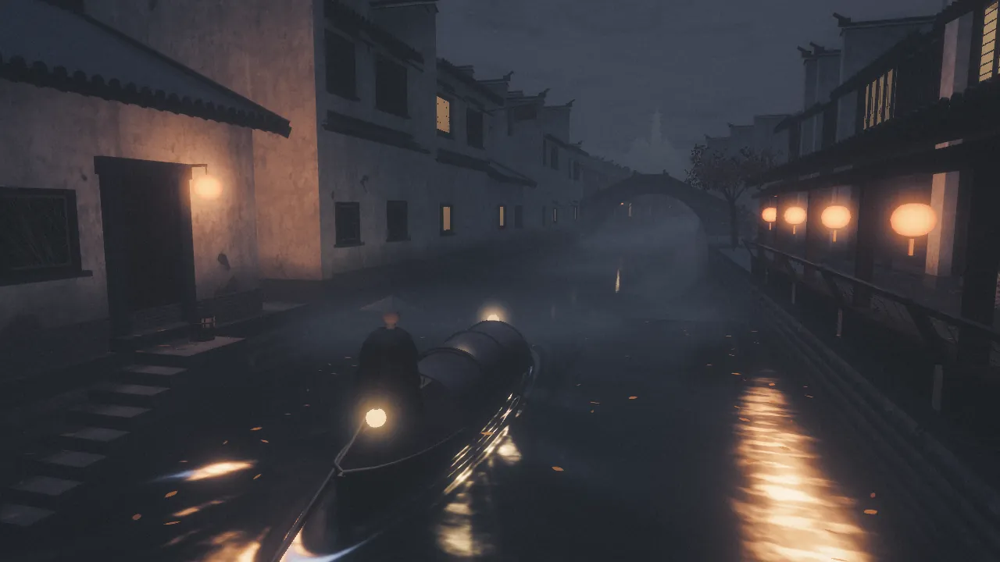</a><br><b>秋 · 夜半钟声</b>：子夜薄雾，屋顶结霜，秋虫唧唧，远处寺里的钟声</td></tr>
<tr><td width="50%" align="center" valign="top"><a href="docs/media/winter-snow.webp">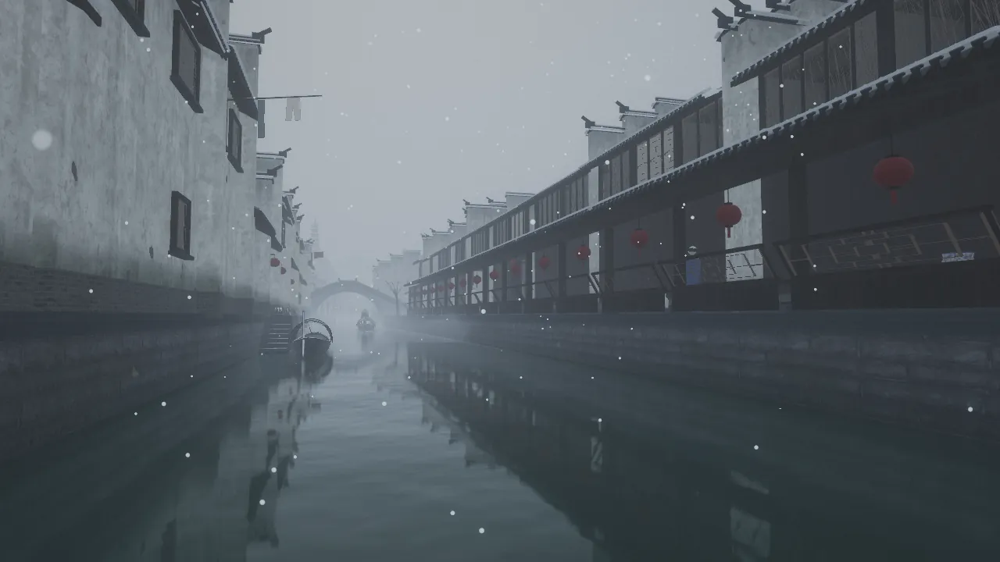</a><br><b>冬 · 细雪</b>：檐上一道道白，船篷、斗笠和伞上都积着雪，雪落几乎无声</td><td width="50%" align="center" valign="top"><a href="docs/media/winter-roofs.webp">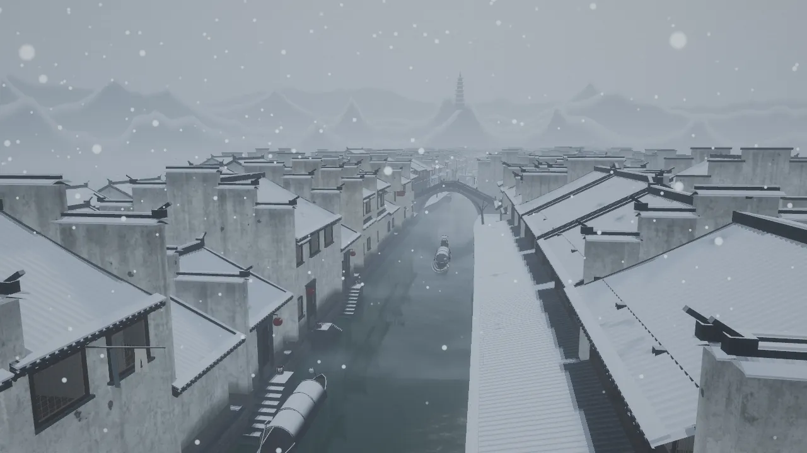</a><br><b>冬 · 白雪黑瓦</b>：俯瞰雪中的镇子，远山和宝塔也白了</td></tr>
<tr><td width="50%" align="center" valign="top"><a href="docs/media/dusk.webp">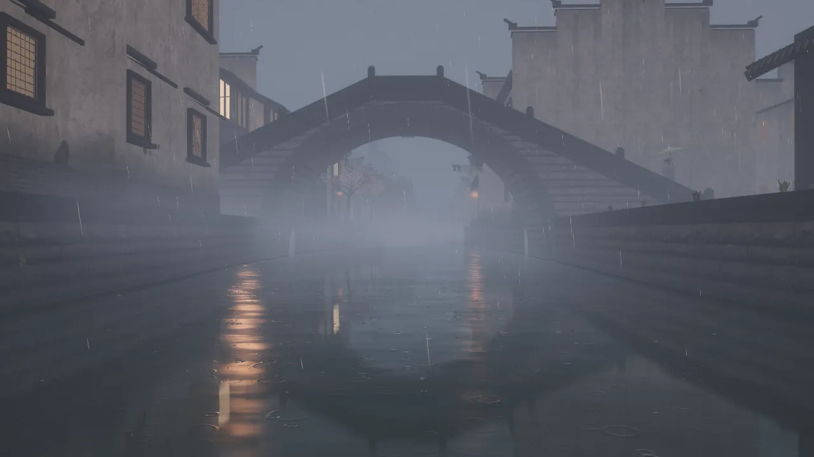</a><br><b>黄昏</b>：窗灯一盏盏亮起，灯光在水里拉成碎光柱</td><td width="50%" align="center" valign="top"><a href="docs/media/journey.webp">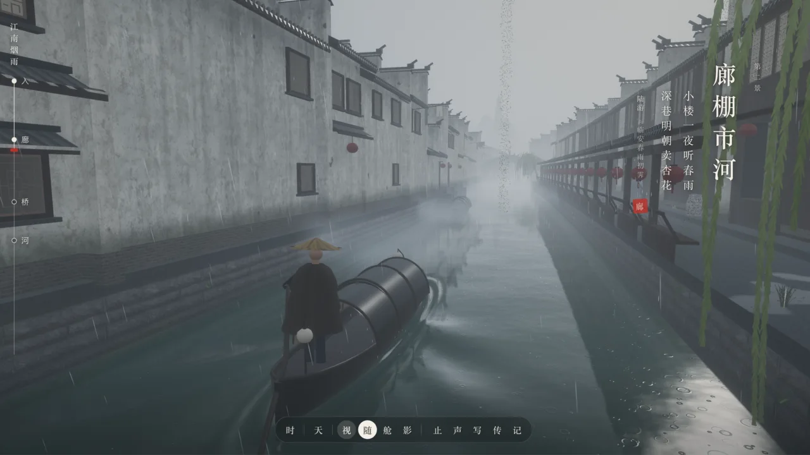</a><br><b>旅程界面</b>：左侧长卷、底栏的季节、时辰、天气和视角</td></tr>
</table>

## 特色

- **四季**：春天杏花开、柳絮飞、清晨鸟叫；夏天柳色深绿，荷叶出水开花，午后骤雨"白雨跳珠"，夜里萤火低飞、蛙声一片，白天蝉鸣；秋天柳叶一片片转黄，江枫红透，落叶漂在水上、铺在檐下，残荷枯梗，晴夜结霜，秋虫唧唧；冬天柳树只剩枝条，屋顶、石板、船篷积雪，檐口一道道白，远山白头。换季时几秒内慢慢过渡
- **烟雨本身**：雨丝、水面涟漪、檐下滴水、湿漉漉的青石板和积水、贴着水面飘的雾，遮雨图让廊棚、屋檐和桥洞下没有雨、地面是干的
- **水**：沿反射光线取倒影、涟漪打碎倒影、折射与吸收、船的尾迹；夜里灯笼在水面拉出碎光柱
- **程序化的江南**：马头墙、小青瓦、美人靠、河埠头、单孔石拱桥、三孔石板桥、廊棚、牌坊，约 550 栋房子，每次打开都是同一座镇
- **生命感**：垂柳、江枫、杏花、荷、船夫摇橹的乌篷船、撑油纸伞的行人（雨停或进廊棚就收伞）、酒旗和晾衣
- **时辰与夜**：窗灯逐盏亮起，窗后有纵深的房间，深夜熄灯，清晨灯笼先灭
- **声音**：雨分远处雨幕、落在水面和石板、打在头顶篷顶几层，进廊棚、钻桥洞、坐进船舱时音色会变；滴水、摇橹吱呀与划水、雷声、子夜和清晨的钟声；春晨的鸟、夏天的蝉和蛙、秋夜的虫和风吹落叶、雪落的沙沙声，全部由 Web Audio 实时合成
- **跑得动**：渲染分辨率自动调节，细节分级，手机自动用低画质档

## 运行

```bash
npm install
npm run dev          # http://localhost:5192
```

`npm run build` 把静态站点输出到 `dist/`（相对路径，放在任何子路径下都能打开），`npm run preview` 在 5193 端口预览构建结果。

贴图和道具模型存放在 `public/assets/`，不需要另外下载。想换贴图或重新生成时运行 `npm run fetch-assets`，再运行 `node scripts/simplify-props.mjs` 把道具扫描模型减到每个约一千个三角形、贴图缩到 256（都需要 ImageMagick）。

推荐新版 Chrome、Edge 或 Safari，需要 WebGL2。

## 里程碑

| 阶段 | 内容 | 状态 |
|---|---|---|
| M0 | 骨架：工程、渲染管线、共享参数、时辰与天气、调速器、截图脚本 | ✅ |
| M1 | 一段水巷：程序化民居、石拱桥、驳岸、水面、雨、雾 | ✅ |
| M2 | 雨雾细节：遮雨图、廊棚、檐下滴水、积水、贴水雾带、水墨远山 | ✅ |
| M3 | 生命感：垂柳、乌篷船与船夫摇橹、尾迹、撑伞行人、酒旗晾衣、道具、杂草荷叶芭蕉 | ✅ |
| M4 | 旅程与交互：开篇、坐船顺河而下四景、诗笺、跟随 / 船舱 / 电影 / 拍照四种视角、底栏、章节跳转、分享链接、镇口牌坊 | ✅ |
| M5 | 时辰与夜：窗灯逐盏亮起、深夜熄灯、窗后伪室内、店铺灯笼、灯笼光晕、水面碎光柱、夜云映灯、晨间熄灯 | ✅ |
| M6 | 声音：远处雨幕、雨落水面和石板、头顶雨打篷顶，廊下和桥洞里变闷、起回声；檐下滴水、摇橹吱呀与划水、水声、雷声、子夜和清晨的钟声，都由 Web Audio 实时合成 | ✅ |
| M7 | 四季框架与冬：季节和天气并列，每一程换季；细雪、大雪与积雪，枯柳，远山积雪，冬天的诗；声音默认静音 | ✅ |
| M7.1 | 冬天修补：檐上雪线、船和行人过桥不掉雪、雪夜更亮、宝塔积雪、冒烟测试脚本 | ✅ |
| M8 | 秋：黄柳、江枫、落叶（飘落、漂水、铺地）、残荷枯梗、霜、秋虫，秋天的诗 | ✅ |
| M9 | 夏：深绿、出水荷与荷花、骤雨跳珠、萤火虫、蝉和蛙，夏天的诗；四季八程 | ✅ |
| M9.1 · M10 | 夏天修补；春的补充（杏花与落瓣、柳絮、清晨鸟鸣）、四季过渡与诗笺通查、性能检查、本页更新 | ✅ |

## 旅程

打开页面是开篇，一首按这一程季节选的诗。点「启程」或按回车，你的乌篷船就从镇口牌坊外顺河而下，依次经过四景，每到一景右侧浮出一张竖排诗笺，诗也按季节换：

| | 开篇 | 一 烟雨入镇 | 二 廊棚市河 | 三 石桥烟柳 | 四 枕河人家 |
|---|---|---|---|---|---|
| 春 | 杜牧《江南春》 | 韦庄《菩萨蛮》 | 陆游《临安春雨初霁》 | 志南《绝句》 | 杜荀鹤《送人游吴》 |
| 夏 | 杨万里《晓出净慈寺送林子方》 | 赵师秀《约客》 | 贺铸《青玉案》 | 苏轼《六月二十七日望湖楼醉书》 | 李重元《忆王孙·夏词》 |
| 秋 | 杜牧《寄扬州韩绰判官》 | 李商隐《宿骆氏亭寄怀崔雍崔衮》 | 李清照《声声慢》 | 张继《枫桥夜泊》 | 李商隐《夜雨寄北》 |
| 冬 | 柳宗元《江雪》 | 张岱《湖心亭看雪》 | 白居易《问刘十九》 | 郑谷《雪中偶题》 | 白居易《夜雪》 |

诗和景是对上的：春天廊棚口和桥头开着杏花（"深巷明朝卖杏花""沾衣欲湿杏花雨"），夏天入镇处的荷塘里有蛙（"青草池塘处处蛙"），秋天桥头是江枫、子夜有钟声（"江枫渔火对愁眠""夜半钟声到客船"），冬天的镇子"上下一白"。

一程四分多钟。到镇尾落下一张纸，换一个季节、时辰和天气再从镇口出发，八程四季轮换：

春·辰时·细雨 → 夏·未时·骤雨 → 秋·酉时·雨后 → 冬·巳时·细雪 → 春·卯时·薄雾 → 夏·戌时·雨后 → 秋·子时·薄雾 → 冬·申时·大雪

季节、时辰和天气在底栏手动改过之后就不再跟着行程走，点「自」恢复。

声音默认静音，按 M 或点底栏的「静」打开，本机会记住。

| 操作 | 说明 |
|---|---|
| W / S · ↑ / ↓ | 快一些 · 慢一些 |
| A / D · ← / → | 掌舵，在河道里左右偏 |
| 拖动 · 滚轮 · 双指 | 环顾 · 远近（双指缩放只在跟随视角下有效） |
| C | 跟随 → 船舱 → 电影 轮换。电影视角会在桥洞、廊下、岸边、船头、高处之间切镜，船快到拱桥时从桥洞另一侧回望 |
| 空格 | 停船 · 启程 |
| P | 拍照：取景框，快门存一张带「江南烟雨」印章的 PNG |
| M | 声音开关，本机记住 |
| H · Esc | 隐藏界面 · 关闭弹层 |
| 左侧长卷 | 四景的位置和船走到哪里，点一景跳过去 |
| 底栏 季 · 时 · 天 · 视 | 季节、时辰滑杆（4:30 到次日 4:30）、天气、视角；止（停船）、声（声音，静音时显示「静」）、写（拍照）、传（复制这一刻的链接）、记（关于） |

地址栏随行程更新（`?z=` 船的位置，第二程起加 `j` 程数，手动设过时再带上 `s` `h` `w` `mode`），复制下来打开就是同一地点、同一季节、时辰和天气，不经过开篇。地址栏还会保留本机的 `q` `scale` `ui`，分享出去的链接不带这些。

## 评审模式

带 `shot`、`cam` 或 `review` 参数打开是评审模式：没有旅程，右下是评审面板。

| 操作 | 说明 |
|---|---|
| 右下面板 · 镜头 | 水巷、拱桥、河埠头、廊棚（从水上看）、廊下（站在廊棚里）、沿街、柳岸七个固定机位，漫游（沿河以船的高度前行），自由（环绕） |
| 拖拽 · 滚轮 | 环顾 · 缩放（在固定机位里拖动会切到自由镜头） |
| 季节 | 春、夏、秋、冬 |
| 时辰滑杆 | 4:30 到次日 4:30，按十二时辰显示 |
| 天气 | 薄雾、细雨、中雨、骤雨、雨后、细雪、大雪 |
| H | 隐藏界面 |
| M | 声音开关（默认静音） |

## URL 参数

| 参数 | 含义 | 示例 |
|---|---|---|
| `z` | 旅程：船在河道上的位置，74（镇口）到 −252（镇尾） | `z=-60` |
| `mode` | 旅程：视角 `follow` `seat` `cinema` | `mode=cinema` |
| `intro` | 旅程：带了 `z` `h` `w` `mode` 也照样先看开篇 | `z=-60&intro` |
| `review` | 进评审模式 | `review` |
| `shot` | 评审机位：`alley` `bridge` `pier` `corridor` `lane` `street` `willows` `glide` `free`，调试用 `roofs` `landing` `hills` `boat` `gate` | `shot=bridge` |
| `warm` | 先让船和行人空跑这么多秒再出第一帧（尾迹要有一段航迹才看得出来），最多 120 | `warm=20` |
| `j` | 旅程：第几程（0 是第一程，八程一轮），决定这一程的季节、时辰和天气 | `j=3` |
| `s` | 季节：`spring` `summer` `autumn` `winter` | `s=autumn` |
| `h` | 时刻，0–24（两个面板的时辰滑杆从 4:30 到次日 4:30） | `h=17.7` |
| `w` | 天气：`mist` `drizzle` `rain` `storm` `after` `snow` `blizzard` | `w=snow` |
| `cam`、`look`、`fov` | 固定的镜头位置、注视点（`x,y,z`）和视角 | `cam=8,6,-70&look=0,2,-95` |
| `q` | 画质档：`high`（桌面默认）；`mobile`（手机和小平板默认：不开 MSAA，阴影、倒影、bloom 和雨丝减量，像素比最多 1.5）；`low` 关掉 MSAA 和阴影、缩小倒影，给没有独立显卡的机器用 | `q=low` |
| `scale` | 渲染分辨率比例，0.25–1 | `scale=0.5` |
| `ui` | `ui=0` 隐藏界面 | |

例如：[雨后的拱桥](http://localhost:5192/?shot=bridge&w=after&h=14)，[黄昏细雨](http://localhost:5192/?shot=bridge&h=17.7)，[杏花细雨](http://localhost:5192/?z=-100&s=spring&w=drizzle&h=10)，[夏夜荷塘](http://localhost:5192/?z=58&j=5)，[江枫](http://localhost:5192/?z=-58&j=2)，[雪中的廊棚](http://localhost:5192/?shot=corridor&s=winter&w=snow&h=10)。（先 `npm run dev`。）

## 截图脚本

```bash
npm run dev &
node scripts/capture.mjs                          # alley / bridge / pier 三张，存到 captures/
node scripts/capture.mjs "dusk:shot=bridge&h=18"  # 名字:参数
SOFT=1 node scripts/capture.mjs                   # 没有 GPU 的机器用软件渲染（很慢，约 1 分钟一张）
```

环境变量：`URL`、`OUT`、`W`/`H`（默认 960×540）、`Q`（默认 `low`）、`CHROME`（浏览器路径）、`PARAMS`（每张都加的参数）、`UI=1`（保留界面，默认加 `ui=0`）、`KEEPLOAD=1`（保留开篇页）、`WAIT`（画面出来后再等几秒，给界面动画）。

旅程的截图用 `名字:参数` 的写法，不带 `shot`，例如 `UI=1 WAIT=8 node scripts/capture.mjs "bridge:z=-50&mode=cinema"`。

`npm run smoke`（先 `npm run dev`）逐个季节和天气、正午和夜里，在旅程和评审两种模式下各画两帧，检查着色器和控制台有没有报错，有问题时退出码为 1。

## 目录结构

```
src/
├── main.js           启动、帧循环，旅程与评审两种入口
├── core/             共享参数与材质补丁、渲染管线与调速器、后期、贴图加载、画质分档、遮雨图（occlusion.js）
├── env/              时辰、天气与季节：目标值缓动进共享参数，积雪的积与化，霜
├── world/
│   ├── layout.js     河道中心线、宽度、两岸哪边临水哪边是街、拱桥位置
│   ├── kit.js        几何构件累加器：零件按材质合并成网格，带墙脚/檐口高度属性
│   ├── materials.js  粉墙、黛瓦、驳岸石、青石板、木作、窗格等材质着色
│   ├── house.js      房屋语法：开间、进深、层数、山墙（硬山 / 马头墙）、临水后墙或沿街铺面、腰檐、河埠头
│   ├── town.js       沿两岸三排地块的规划与分块构建，瓦当滴水实例化
│   ├── banks.js      驳岸、压顶石、石板地面、河床、沿街的河埠头
│   ├── bridge.js     单孔半圆石拱桥
│   ├── slabbridge.js 枕河人家的两座三孔石板桥
│   ├── corridor.js   沿河廊棚：坡顶、木柱、美人靠、红灯笼
│   ├── hills.js      水墨远山与塔
│   ├── willow.js     垂柳：树干、拱起的枝、随风摆的柳丝，柳叶按季节变色和落下；在其中几处种江枫和杏花
│   ├── maple.js      江枫与杏花：树干和枝并进柳树的网格，树冠卡片随季节开花、变绿、变红、落尽
│   ├── boat.js       乌篷船、船夫摇橹、河上往来的船
│   ├── people.js     撑油纸伞的行人：沿河、过桥，雨停或进廊棚收伞
│   ├── cloth.js      酒旗、晾衣，随风摆
│   ├── props.js      木桶、竹篮、酒坛、花盆（Poly Haven 扫描模型）
│   ├── plants.js     墙根杂草、驳岸蕨草、芭蕉；荷：水面荷叶、夏天出水的荷叶荷花、秋冬的断梗
│   ├── gate.js       镇口牌坊
│   ├── water.js      水面：沿反射光线取倒影、涟漪粗糙度模糊、折射与吸收、雨点涟漪、船的尾迹
│   ├── sky.js        阴天云层与天空
│   └── textures.js   程序化窗格图集（方格、步步锦、冰裂纹、回纹）
├── fx/               雨丝（rain.js）、雪花与柳絮（snow.js）、檐下与篷沿滴水（drips.js）、骤雨溅起的水珠（splash.js）、落叶与花瓣（leaves.js）、萤火虫（fireflies.js）、贴水雾带（mist.js）、灯笼光晕（halos.js）
├── audio/            声音：合成（synth.js：噪声、雨滴、滴水、橹声、雷、钟、鸟、蝉、蛙、秋虫、落叶、混响尾音）、混音与触发（soundscape.js：遮蔽、滴水、摇橹、钟声、雷声、四季的虫鸟、静音）
├── journey/
│   ├── route.js      航线：起止、四景与四季的诗、每一程的季节时辰天气、船能偏离航线多远
│   ├── journey.js    船的行进：巡航与快慢、掌舵、到景、到头
│   ├── director.js   旅程镜头：跟随、船舱、电影切镜、拍照
│   └── camera.js     评审模式的固定机位、漫游、自由环绕
└── ui/               旅程界面（journey-ui.js：开篇、诗笺、长卷、底栏、拍照、分享）、评审面板（panel.js）
scripts/              贴图下载、截图、性能统计（perf.mjs）、冒烟测试（smoke.mjs）
docs/PLAN.md          实现计划与里程碑
docs/media/           本页的截图
```

## 常见修改

- 改房子的比例、出现概率：`world/town.js` 的 `planRow`（开间、进深、层数、山墙类型、腰檐、河埠头）
- 改某类构件的样子：`world/house.js`（`roof`、`firewall`、`waterFace`、`shopFace`、`waistEave`、`pierSteps`）
- 改墙面的雨痕、返潮、剥落：`world/materials.js` 的 `plaster`
- 改天气：`env/environment.js` 的 `WEATHERS`；雾的浓度在同文件 `uFogParams` 一行
- 改季节：各季的光和空气、积雪积化的快慢、霜在 `env/environment.js` 的 `update`；草木各季的颜色在各自的材质里（柳叶在 `world/willow.js`，江枫和杏花在 `world/maple.js`，草、芭蕉、荷在 `world/plants.js`，青苔在 `world/materials.js`），都读 `uSeason`
- 改廊棚的位置和长度：`world/layout.js` 的 `CORRIDOR`；灯笼和美人靠在 `world/corridor.js` 的 `bay`
- 改积水的多少：`world/materials.js` 的 `slab` 里 `level` 一行；贴水雾的浓淡：`fx/mist.js` 的 `dens`
- 改远山：`world/hills.js` 的 `RINGS`（半径、高度、起伏）和塔的位置 `PAGODA_AIM`
- 改柳树的位置和疏密：`world/willow.js` 的 `planWillows`（间距）和 `createWillows`（主枝数、每枝柳丝数、柳丝长度）；江枫和杏花种在哪里：同文件的 `MAPLES`、`APRICOTS`
- 改荷塘：`world/plants.js` 的 `PONDS`；落叶、花瓣、柳絮、萤火虫、水珠的数量：`core/quality.js` 的各画质档
- 改船：船型在 `world/boat.js` 顶部的 `hullW` `sheer` `draft`；往来的船数和速度在 `main.js` 与 `BoatTraffic`
- 改行人：人数在 `main.js` 的 `new People(10)`，衣服和伞的颜色在 `world/people.js` 顶部
- 改四景的位置、四季的诗句和印章字，每一程的季节时辰天气：`journey/route.js` 的 `CHAPTERS`、`LOOPS`；开篇的诗是同文件的 `OPENINGS`
- 改船速：`journey/journey.js` 的 `cruise`（米/秒）；电影视角的镜头：`journey/director.js` 的 `nextShot` 和 `update`；手机竖着拿时的取景：同文件的 `MIN_ACROSS`（横向至少看多宽）、`MAX_TALL`，跟随视角里的 `tall`
- 改牌坊的位置和匾额：`world/layout.js` 的 `GATE`；石板桥的位置和尺寸：同文件的 `SLAB_BRIDGES`、`SLAB`（桥头那栋临水房子会自动让出来，柳树和河埠头也会避开）
- 改临水立面：`world/house.js` 的 `floorsOf`（每栋房子的层高）、`upperTimber`（多少房子用木构二层）、`balconyZ`（美人靠挑台）
- 改夜景：窗灯亮起的先后、不亮的比例、深夜熄灯在 `world/materials.js` 的 `jnLit`，窗后房间在 `jnRoom`；灯笼何时点亮、何时熄灭和深夜熄窗的时刻在 `env/environment.js`（`lampOn`、`uWinOff`）；灯笼照多远在 `core/shared.js` 的 `sfLamps`；光晕大小在 `fx/halos.js`；店铺灯笼的多少在 `world/house.js` 的 `shopFace`
- 改声音：各层音量和雨量的对应、虫鸟什么时候叫在 `audio/soundscape.js` 的 `params`，哪里算有顶遮着在同文件的 `shelter`；滴水、摇橹、钟声的触发在 `drips`、`oars`、`bells`（钟声的时辰在 `bellHours`），雷声在 `strike`；音色本身在 `audio/synth.js`（钟的分音在 `PARTIALS`）
- 调试：浏览器控制台里的 `jiangnan.app.setShot('bridge')`（评审模式）、`jiangnan.app.setSeason('autumn')`、`jiangnan.app.setWeather('after')`、`jiangnan.app.setHours(18)`、`jiangnan.app.jumpTo(2)`（旅程跳到第三景）、`jiangnan.sound.level()`（此刻的音量）

## 性能

- 渲染分辨率由调速器在 0.5–1.0 之间自动调整，保持帧时间在预算内（`?q=low` 时关闭）
- 镇子按 80 m 分块合并网格，每块按材质一个 draw call；第一排房子在整条航线上用完整细节，航线以外越远越简
- 完整细节的房子每 60 m 一段，每段同时建一份低一级细节的副本：镜头 55–65 m 以内画完整细节，倒影和远处画副本（倒影的分辨率只有四分之一，又被涟漪打碎，完整细节在那里是浪费）。房屋生成里只有完整细节才用到的随机选择（窗格花样）单独取随机数，所以副本和原屋的门窗位置一模一样
- 瓦当和滴水用实例化绘制，按岸每 40 m 一批，能被视锥裁掉，75 m 以外不画；不参与倒影和遮雨图
- 道具扫描模型减到每个约一千个三角形，不投影子
- 阴影框放在镜头前方，按阴影贴图的像素对齐移动（船走时阴影边缘不爬动）；阳光弱时（雨天、夜里）阴影图每 8 帧才重画一次
- 遮雨图只在镜头移动超过 10 m 时重画一次（俯视的纯深度渲染，只画建筑），雨丝、积水、水面涟漪和地面干湿都查这张图
- 手机和小平板自动用 `mobile` 档
- 季节限定的东西不在季时不画：没有雨、雪、落叶、柳絮时对应的粒子网格整个跳过，夏天的出水荷按两处荷塘分批、离开 110 m 就不画，冬天不画江枫和杏花的树冠；水面和石板上的落叶只在秋天（花瓣只在春天）才计算
- 声音默认静音，打开声音时才建 AudioContext，所有声音都在之后的几帧里分块合成（每块十几毫秒以内，蝉和鸟一只一块）；雷声要选了骤雨、钟声要到了它的时辰、各季的虫鸟要到了那个季节才合成；静音或页面切到后台时 AudioContext 挂起
- 测量：`node scripts/perf.mjs "z=-22&h=19.5&q=high&ui=0"` 逐通道统计 draw call、三角形和显存（先 `npm run dev`）

## 致谢

代码思路来自 [Sakura Fantasy](https://github.com/billpwchan/sakura-fantasy)（MIT），贴图和道具模型来自 [Poly Haven](https://polyhaven.com)（CC0），声音全部由代码合成，诗句出自杜牧、韦庄、陆游、志南、杜荀鹤、杨万里、赵师秀、贺铸、苏轼、李重元、李商隐、李清照、张继、柳宗元、张岱、白居易、郑谷。详见 [CREDITS.md](CREDITS.md)。
